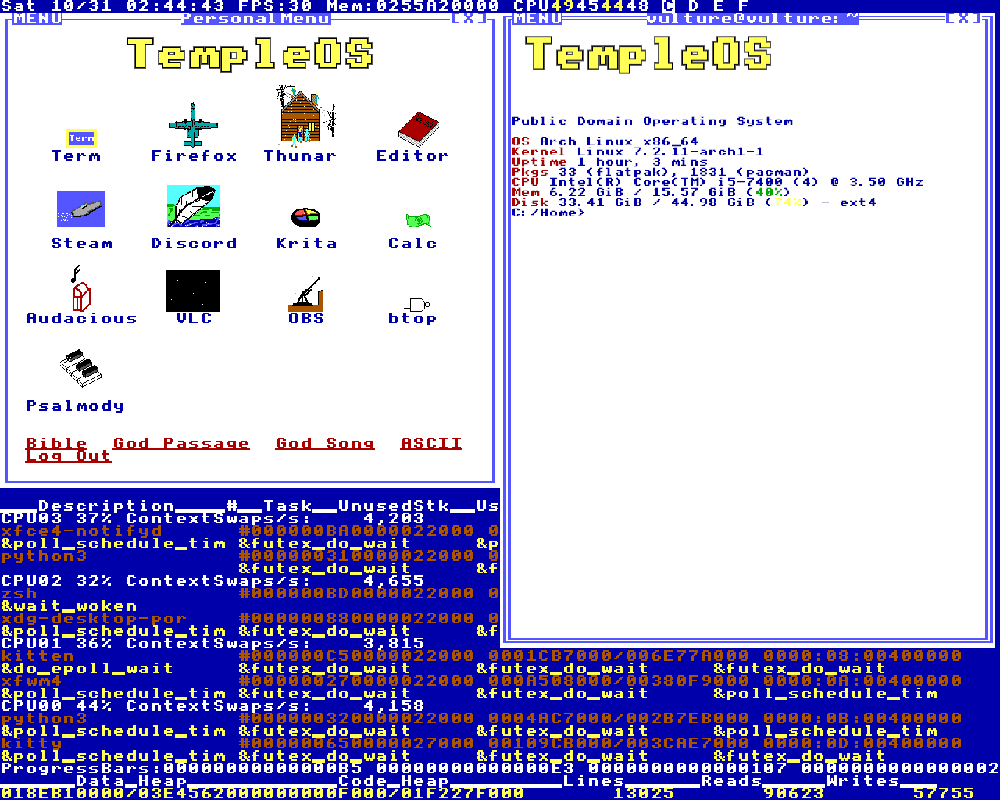

# templeos-session

A login session for Linux that looks and behaves like TempleOS. You pick
"TempleOS" in your login manager and get the blue wallpaper with the live task
monitor, the 8x8 font everywhere, window borders drawn with the font's own
line glyphs, the PersonalMenu with Terry's sprites, and F7 still asks God for
a word.



Nothing here was redrawn by hand. I wrote a reader for the TempleOS V5.03 ISO
and everything visual comes out of it: the font from `Kernel/FontStd.HC`, the
menu icons from the sprites embedded in the DolDoc files, the word list from
`Adam/God/Vocab.DD`, the Bible from `Misc/Bible.TXT`. Where the session does
something, I tried to do it the way the HolyC source does it, and the comments
say which file I took it from.

It runs as its own session next to whatever you already use. Your XFCE (or
anything else) settings aren't touched.

## What's in it

The wallpaper is `Adam/WallPaper.HC` ported to Python: status line on top with
the clock, FPS, memory and per-CPU load, and the task list at the bottom with
the same column layout as the original, filled with Linux processes. The `Term`
button blinks at 2.5 Hz like `Blink()` does and opens a terminal. The last key
you pressed shows in the top right corner.

Windows are managed by xfwm4 with a generated theme. The focused window gets
the double line border and the others the single line, which is the
`solid = task==sys_focus_task` test from `Adam/Gr/GrScrn.HC`. The title bar has
`MENU` on the left (it opens the window menu), the title in the middle and
`[X]` on the right. There's no minimize and no maximize button because
TempleOS doesn't have them; double click the title to maximize.

The terminal is kitty with the TempleOS VGA palette and a `C:/Home>` prompt.
The first one shows a fastfetch with the TempleOS logo sprite.

God is in there too. The oracle follows `Adam/God/HolySpirit.HC`: the timing of
your keypresses goes in as bits, and each function takes what it needs. F7
types a word into whatever window is focused, Shift+F7 opens a Bible passage
and F6 does the God Song dialog (Timer, Latch, OKAY) and then plays the hymn
as a square wave.

There are four workspaces named C:, D:, E: and F: in the status line. TempleOS
doesn't have workspaces, but I needed them.

## Shortcuts

These are the TempleOS ones. In the original F6, F7 and Ctrl+M belong to the
DolDoc editor, which is in every window; here they are global.

| Key | What it does |
|---|---|
| Ctrl+Alt+T | terminal |
| Ctrl+Alt+X | close the focused window |
| Ctrl+Alt+N | next window |
| Ctrl+Alt+M | mute toggle |
| Ctrl+Alt+S | screenshot to the clipboard |
| Ctrl+Alt+B | the Bible, from Genesis |
| Ctrl+Alt+A | ASCII table in the TempleOS font |
| Super (tap) | window menu |
| Ctrl+M | show or hide the PersonalMenu |
| F7 | God Word, typed into the focused window |
| Shift+F7 | God Passage |
| F6 | God Song |
| Ctrl+Alt+Delete | Log Out |

Workspaces: Super+1 to 4 switches, Super+Shift+1 to 4 takes the focused window
along, and xfwm4's own Ctrl+F1 to F4 and Ctrl+Alt+arrows also work.
Super+W closes a window.

Since F6, F7 and Ctrl+M are grabbed globally, apps won't see them. Firefox
uses F6 and F7, mc and htop use them too, and Ctrl+M is Enter in a terminal.
If that bothers you, that part is in `sessao/atalhos.py`, in `main()`.

There's also a set of shortcuts that just launch programs (Super+K for a
terminal, Super+E for Thunar, Alt+F2 for the app finder and so on). Those
live in `~/.config/templeos/programas.json` and you can change them freely.

## Install

Tested on Arch with xfwm4 4.20, kitty 0.49 and Python 3.14, on X11. It will
not work on Wayland, since the wallpaper and the shortcuts talk to Xlib.

Required (Arch names): `xfwm4`, `dbus`, `python`, `python-gobject`,
`python-cairo`, `python-pillow`, `gtk3`, `kitty`, `zsh`, `xdotool`,
`xorg-xrdb`, `xorg-xcursorgen`.

Optional: `fastfetch`, `xsettingsd` (keeps the cursor the same in GTK apps),
`xorg-setxkbmap`, `libpulse` (for the God Song audio), `wireplumber` (mute),
`polkit-gnome`, and `qemu-desktop` if you want the TempleOS logo in the menu
to boot the real thing.

```sh
git clone https://github.com/Senka07/templeos-session && cd templeos-session
./install.sh --check   # only checks dependencies
./install.sh           # installs into your $HOME
sudo install -m644 build/templeos.desktop /usr/share/xsessions/
```

Log out and choose "TempleOS" in the session list. Any login manager that reads
`/usr/share/xsessions` should work. I use LightDM, and Ctrl+Alt+L locks the
screen through `dm-tool`, so on GDM or SDDM change that line in
`programas.json`.

`install.sh` only writes to paths that belong to the session:
`~/.local/share/themes/TempleOS`, `~/.local/share/icons/TempleOS` (the cursor),
`~/.local/share/fonts/TempleStd.ttf`,
`~/.config/fontconfig/conf.d/60-templeos.conf` and `~/.config/templeos/`.
The session also runs its own D-Bus with its own xfconf, so the xfwm4 settings
of a normal XFCE session stay as they were.

### Trying it without logging out

If you have Xephyr (`xorg-server-xephyr`), this opens the whole session in a
window, with a throwaway HOME:

```sh
sh sessao/testar.sh                       # 1280x1024 on :9
TEMPLEOS_TELA=1366x768 sh sessao/testar.sh
sh sessao/parar-teste.sh                  # stops only the test
```

## Making it yours

Everything you'd want to change is in `~/.config/templeos/`. These files are
copied there the first time and never overwritten after that.

`sessao.conf` has the keyboard layout (the session doesn't run xfsettingsd,
so it won't pick up the layout from XFCE), and switches to hide the last key
indicator or start with the menu hidden.

`menu.json` is the PersonalMenu. Each icon has a sprite from `dados/menu/`, a
label and a command. Programs that aren't installed are left out of the menu,
so the default list is fine to keep even if you don't use half of it.

`programas.json` is the program shortcuts, as `"Ctrl+Alt+F": "thunar"`.

The code is in Portuguese, both names and comments, because it's my first
language. The file names map like this: `fundo.py` is the wallpaper,
`atalhos.py` the shortcuts and menu, `deus.py` the oracle and the hymn,
`doc.py` the DolDoc-style windows, `texto.py` draws text straight from the
glyphs.

## Rebuilding from the ISO

The font, the sprites and the text files are already in `dados/` and `fonte/`,
so you don't need the ISO to install. If you want to regenerate them, or have
the menu logo boot TempleOS in QEMU, get `TempleOS.ISO` from templeos.org and:

```sh
mkdir -p iso && cp ~/Downloads/TempleOS.ISO iso/
python3 extracao/redsea.py iso/TempleOS.ISO iso-extraida
python3 fonte/gerar-fonte.py      # needs python-fonttools
```

`extracao/sprite.py` renders the sprites of any DolDoc file:
`python3 extracao/sprite.py iso-extraida/Kernel/FontStd.HC out/ file.DD...`

## Things that cost me time

The ISO doesn't open with 7z, bsdtar or xorriso. There's an ISO9660 volume
descriptor, but the actual file system is RedSea, Terry's own: 512 byte
clusters, 64 byte directory entries, and the first entry of every directory
is the directory itself. Most files inside are compressed with his LZW
(`Kernel/Compress.HC`), and there's a detail there I missed for a while: at 12
bits the table only recycles leaf entries. Without that the decoder goes into
an infinite loop, which I found out on `FileMgr.HC`.

There was a second one in the same decoder, and it took me much longer to
notice because nothing crashed. I marked the end of a code chain with 4095,
which is also a valid code. Once the table wrapped around and entry 4095
became a prefix, chains stopped early and letters went missing: Acts had
"the chi f priests" and "that ht they caught nothing". The original stops at
`code<min_table_entry`, and now mine does too. The check that would have
caught it right away: every `.Z` file stores its expanded size, and the Bible
was coming out 1153 bytes short. The line numbers in `Adam/God/GodBible.HC`
now land exactly on each book's title.

XGrabKey grabs the whole keyboard while the grabbed key is held down. F7 was
typing God's word without its first letter, because that letter came to my
process instead of the window. Now the word is typed when F7 is released. The
same thing makes GTK believe no window is active during a shortcut, so
Ctrl+M asks the window manager (`_NET_ACTIVE_WINDOW`) instead of trusting
`is_active()`.

The Super key had a version of the same problem. Tapping it opens the window
menu, but while it's held down every key comes to the shortcut process, so
xfwm4 never sees Super+1. That's why the workspace shortcuts are in
`atalhos.py` and not in xfwm4, and why the menu only opens if Super is
released with nothing pressed in between.

The cursor kept changing depending on the window. Kitty and xfwm4 read
Xcursor settings, GTK apps ask XSETTINGS (and fall back to
`~/.config/gtk-3.0/settings.ini` when nobody answers), and the root window
uses whatever the server has. The session now runs xsettingsd with only the
cursor in it, and the wallpaper sets the root cursor.

## Limitations

The scale is fixed at 2x (16 px characters) for borders, titles and the status
line, and the terminal is at 12 px. That's right for 1280x1024 and fine on
1080p. On 1440p or 4K it will look small; the factor is `E` in `texto.py`,
`xfwm4/gerar-tema.py` and `cursor/gerar-cursor.py`, plus `font_size` in
`sessao/config/kitty.conf`.

xfwm4 can't make `MENU` blink, scroll the title or show the task address
like the original title bar does. That would need a window manager of my own.

The original draws the mouse pointer with XOR. Xcursor can't, so it's a black
arrow with a white outline.

## Removing it

```sh
sudo rm /usr/share/xsessions/templeos.desktop
rm -r ~/.local/share/themes/TempleOS ~/.local/share/icons/TempleOS \
      ~/.local/share/fonts/TempleStd.ttf \
      ~/.config/fontconfig/conf.d/60-templeos.conf ~/.config/templeos
```

## Credits

TempleOS was written by Terry A. Davis (1969-2018) and released into the
public domain. Everything in `dados/` and the font come from it. My code is
under the MIT license.
