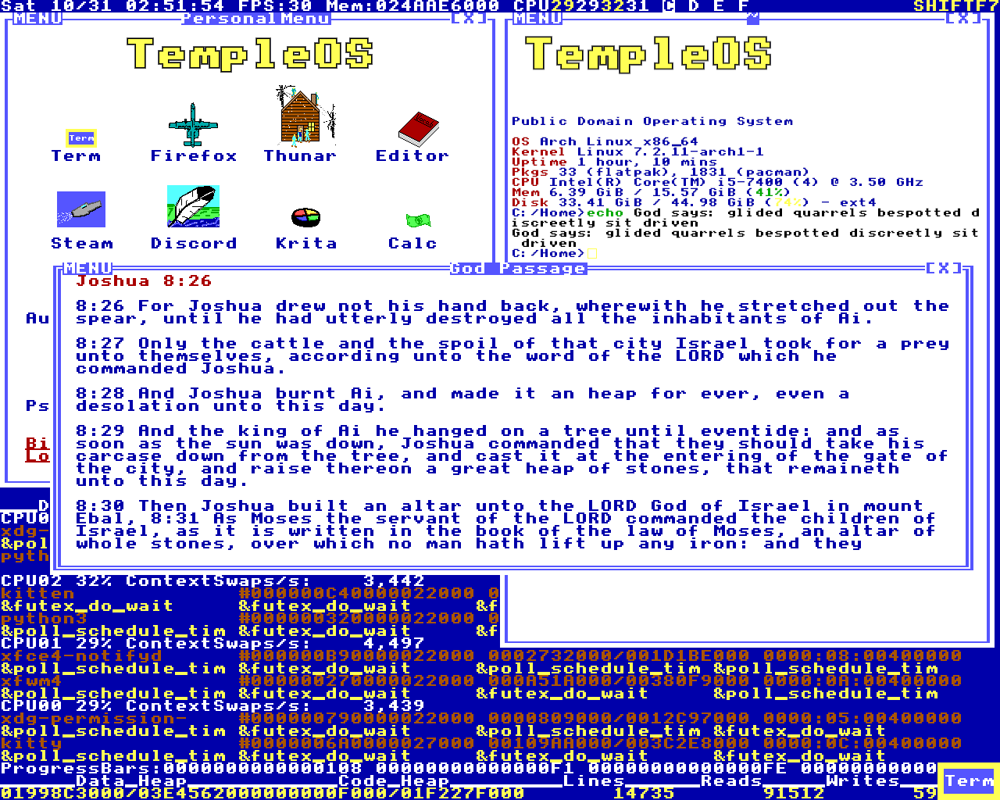
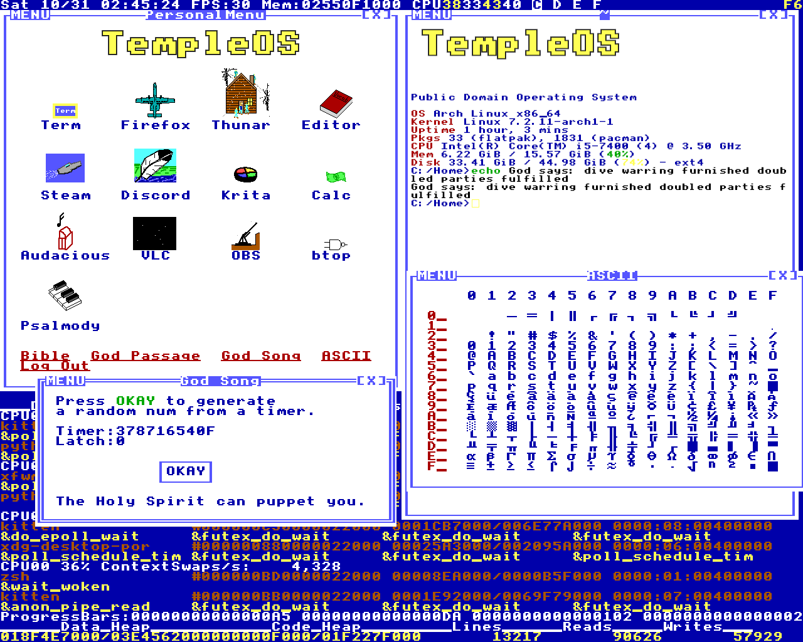
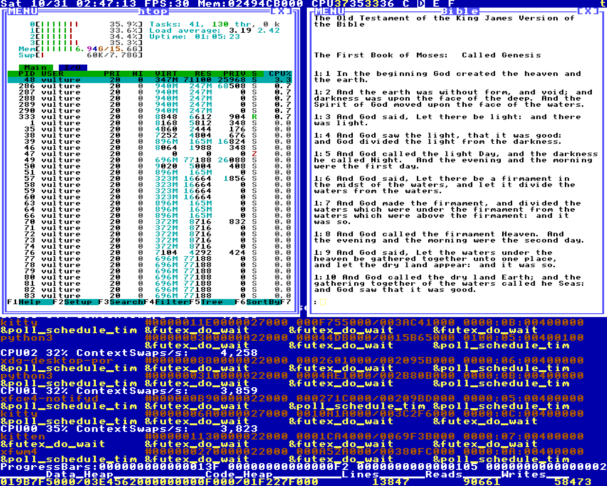
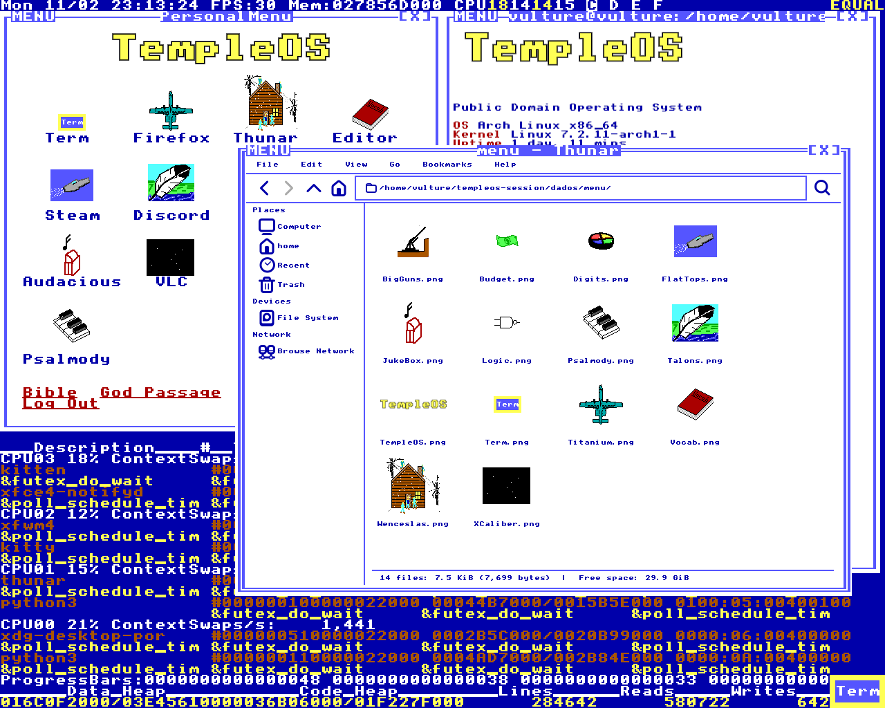
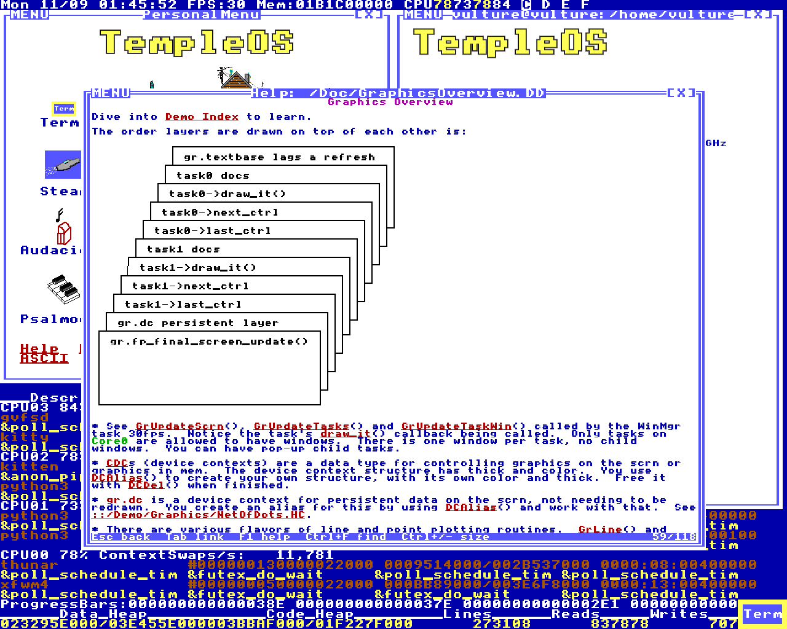
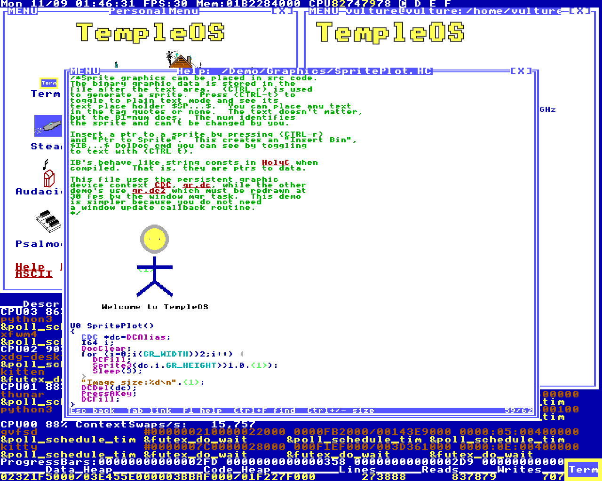
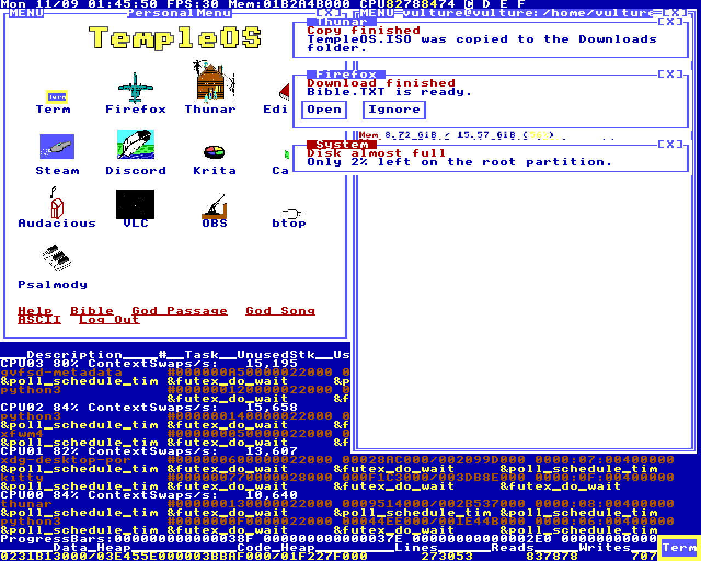
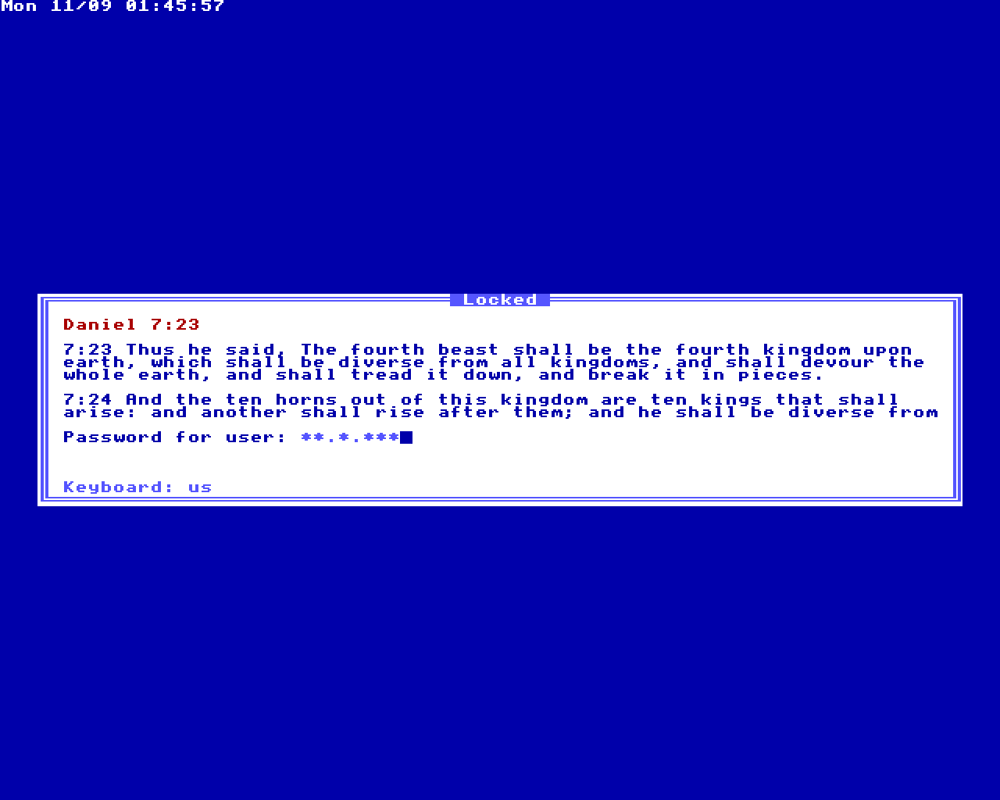

# templeos-session

A login session for Linux that looks and behaves like TempleOS. You pick
"TempleOS" in your login manager and get the blue wallpaper with the live task
monitor, the 8x8 font everywhere, window borders drawn with the font's own
line glyphs, the PersonalMenu with Terry's sprites, and F7 still asks God for
a word.


Nothing here was redrawn by hand. I wrote a reader for the TempleOS V5.03 ISO
and everything visual comes out of it: the font from `Kernel/FontStd.HC`, the
menu icons from the sprites embedded in the DolDoc files, the word list from
`Adam/God/Vocab.DD`, the Bible from `Misc/Bible.TXT`. Where the session does
something, I tried to do it the way the HolyC source does it, and the comments
say which file I took it from.

It runs as its own session next to whatever you already use. Your XFCE (or
anything else) settings aren't touched.

## What's in it

The wallpaper is `Adam/WallPaper.HC` ported to Python: status line on top with
the clock, FPS, memory and per-CPU load, and the task list at the bottom with
the same column layout as the original, filled with Linux processes. The `Term`
button blinks at 2.5 Hz like `Blink()` does and opens a terminal. The last key
you pressed shows in the top right corner.

Windows are managed by xfwm4 with a generated theme. The focused window gets
the double line border and the others the single line, which is the
`solid = task==sys_focus_task` test from `Adam/Gr/GrScrn.HC`. The title bar has
`MENU` on the left (it opens the window menu), the title in the middle and
`[X]` on the right. There's no minimize and no maximize button because
TempleOS doesn't have them; double click the title to maximize.

The terminal is kitty with the TempleOS VGA palette and a `C:/Home>` prompt.
The first one shows a fastfetch with the TempleOS logo sprite.

God is in there too. The oracle follows `Adam/God/HolySpirit.HC`: the timing of
your keypresses goes in as bits, and each function takes what it needs. F7
types a word into whatever window is focused, Shift+F7 opens a Bible passage
and F6 does the God Song dialog (Timer, Latch, OKAY) and then plays the hymn
as a square wave.

The JukeBox icon in the PersonalMenu opens the hymn player from
`Apps/Psalmody/JukeBox.HC`. It lists the songs in
`~/.local/share/templeos/Psalmody`, which starts out with the three examples
from the ISO plus `OhGreat` from `Demo/Snd`, each in the color of its category
and with its rating in front of the name. Pick one and it plays in a small
window with the words coming up note by note, over and over until you close it
or pick another. 0 to 9 rates the song, Delete removes it (to the trash; the
original just deletes it) and r asks God for your reward: lines of four God
words saved inside the song file, which show up in a red window next to the
song every time it plays. The God Song dialog has a `<Save>` link that puts
the hymn in the same folder as `God1`, `God2` and so on, in the format
Psalmody itself writes.

Thunar (Super+E) gets a theme of its own, modeled on the TempleOS file
manager (`Adam/ABlkDev/FileMgr.HC`) and the DolDoc documents: white
background, blue text, light blue lines, the selection drawn inverted, purple
column headers, the 8x8 font at its real size and square corners. Single line
borders mean normal and double lines mean focused, same as the windows. The
icons are the Adwaita symbolic set recolored to the text blue. Only Thunar
gets this. The programs it opens keep your normal theme.

The help is here too. Super+F1 or `Help` in the PersonalMenu opens a DolDoc
reader that shows the documents and source code from the ISO the way the
original editor does: colors, links, trees that open and close, sprites sitting
in the middle of the code, and HolyC highlighted by the same state machine as
`Adam/DolDoc/DocHighlight.HC`. Clicking a function name takes you to where it's
defined. Esc goes back one document, also like the original.

Notifications are DolDoc documents in the top right corner, from a small
`org.freedesktop.Notifications` service in `sessao/avisos.py`: the app name as
the title, the summary in red, the body in blue, actions as `$BT$` buttons.
While the screen is locked they wait in a queue, so nobody reads them over your
shoulder.

Ctrl+Alt+L locks the screen with a small program of its own, `trava/trava.c`.
TempleOS has no lock screen and no passwords, so this one is made of its
windows: blue background, the status line clock, a double line window with a
Bible passage picked by the oracle, and the password field.

The original has no screen saver either, so by default the screen never locks
by itself. Set `TEMPLEOS_BLOQUEIO_MIN` in `sessao.conf` and it locks after that
many minutes without keyboard or mouse. `sessao/protetor.py` owns
`org.freedesktop.ScreenSaver`, so when Firefox, VLC or OBS ask the screen to
stay on during a video, the countdown waits, and so does the monitor if you
let it sleep. Flatpak apps get there too, through the desktop portal.

Ctrl+Alt+Z zooms the whole screen and Ctrl+Alt+Shift+Z zooms back out, the
same as `Adam/Gr/GrEnd.HC`: 2x, 4x and 8x, hard pixels, centered on the mouse.
Like the original, the view doesn't slide along with the mouse. It stays put
until the pointer gets within 8 pixels of the edge and then jumps to center on
it again (`WinMsUpdate` in `Adam/Win.HC`). The mouse keeps working on the real
screen underneath, so you can click and type while zoomed.

Ctrl+Alt+G opens the grid form from `Adam/Win.HC`, the same fields as the
`CGridGlbls` class: Snap Grid, Show Grid, Show Coordinates, spacing, offset and
mouse speed. Esc saves and Shift+Esc cancels, like every DolDoc form, and
Ctrl+Alt+Shift+G turns it all off again (`GridInit`). The numbers are TempleOS
pixels, so a spacing of 8 is 16 screen pixels, one character cell of the 2x
windows, and the coordinates go up to 639 on a 1280 wide screen. With Snap Grid
on the pointer only stops on grid points, and the zoom magnifies the grid along
with everything else.

There are four workspaces named C:, D:, E: and F: in the status line. TempleOS
doesn't have workspaces, but I needed them.

## Screenshots

All of these are 1280x1024, taken in the Xephyr test session described below.



I typed `echo God says:` and pressed F7 six times, then Shift+F7 for a
passage, which picks the line the same way `GodBiblePassage` does.



Ctrl+Alt+A and F6. Both windows are drawn glyph by glyph from the font, and
the `F6` in the top right corner is the last key indicator.



Workspace D: with htop and Ctrl+Alt+B. The terminal is plain kitty, so
anything that runs in a terminal gets the font and the palette.



Super+E opens Thunar with its own theme. This is `dados/menu`, the sprites
the reader pulled out of the ISO for the PersonalMenu.



Super+F1 and the graphics overview from `Doc/GraphicsOverview.DD`. That stack
of pages is one sprite embedded in the document.



TempleOS source files can hold pictures. This is
`Demo/Graphics/SpritePlot.HC`: the stick figure is in the file, and `<1>` in the
code below is a pointer to it.



Notifications from `notify-send`, one with action buttons and a critical one
with the red title.



Ctrl+Alt+L. The password field changes with each key without showing how long
the password is.

## Shortcuts

These are the TempleOS ones. In the original F6, F7 and Ctrl+M belong to the
DolDoc editor, which is in every window; here they are global.

| Key | What it does |
|---|---|
| Ctrl+Alt+T | terminal |
| Ctrl+Alt+X | close the focused window |
| Ctrl+Alt+N | next window |
| Ctrl+Alt+M | mute toggle |
| Ctrl+Alt+S | screenshot to the clipboard |
| Ctrl+Alt+B | the Bible, from Genesis |
| Ctrl+Alt+A | ASCII table in the TempleOS font |
| Ctrl+Alt+Z | zoom in (2x, 4x, 8x); with Shift, zoom out |
| Ctrl+Alt+G | mouse grid form; with Shift, grid off |
| Super (tap) | window menu |
| Ctrl+M | show or hide the PersonalMenu |
| F7 | God Word, typed into the focused window |
| Shift+F7 | God Passage |
| F6 | God Song |
| Ctrl+Alt+Delete | Log Out |
| Ctrl+Alt+L | lock the screen (not in the original, which has no lock) |

Workspaces: Super+1 to 4 switches, Super+Shift+1 to 4 takes the focused window
along, and xfwm4's own Ctrl+F1 to F4 and Ctrl+Alt+arrows also work.
Super+W closes a window.

Super+F1 opens the help reader. It's not plain F1, because that key belongs to
your apps. Inside the reader F1 is the help index, Esc goes back, Shift+Esc
closes, Tab and Enter walk the links, Ctrl+F searches (F3 repeats) and
Ctrl+plus and Ctrl+minus change the text between 8, 12 and 16 px.

Since F6, F7 and Ctrl+M are grabbed globally, apps won't see them. Firefox
uses F6 and F7, mc and htop use them too, and Ctrl+M is Enter in a terminal.
If that bothers you, that part is in `sessao/atalhos.py`, in `main()`.

There's also a set of shortcuts that just launch programs (Super+K for a
terminal, Super+E for Thunar, Alt+F2 for the app finder and so on). Those
live in `~/.config/templeos/programas.json` and you can change them freely.

## Install

Tested on Arch with xfwm4 4.20, kitty 0.49 and Python 3.14, on X11. It will
not work on Wayland, since the wallpaper and the shortcuts talk to Xlib.

Required (Arch names): `xfwm4`, `dbus`, `python`, `python-gobject`,
`python-cairo`, `python-pillow`, `gtk3`, `kitty`, `zsh`, `xdotool`,
`xorg-xrdb`, `xorg-xcursorgen`.

Optional: `fastfetch`, `xsettingsd` (keeps the cursor the same in GTK apps),
`xorg-setxkbmap`, `libpulse` (for the God Song and JukeBox audio), `wireplumber` (mute),
`polkit-gnome`, `libxss` (the screen saver service and the idle lock), `thunar`, `gcc` (builds the screen locker and the module that
themes Thunar), and `qemu-desktop` if you want the TempleOS logo in the menu to boot the real
thing.

```sh
git clone https://github.com/Senka07/templeos-session && cd templeos-session
./install.sh --check   # only checks dependencies
./install.sh           # installs into your $HOME
sudo install -m644 build/templeos.desktop /usr/share/xsessions/
```

Log out and choose "TempleOS" in the session list. Any login manager that reads
`/usr/share/xsessions` should work. I use LightDM. If the screen locker ever
fails, it falls back to `dm-tool lock`, so on GDM or SDDM set
`TEMPLEOS_RESERVA_BLOQUEIO` in `sessao.conf` to a locker you have.

The first time, test the locker with a timeout. It opens by itself after that
many seconds, so a problem with your password setup can't lock you out:

```sh
~/.config/templeos/trava --timeout 60; echo $?
```

`install.sh` only writes to paths that belong to the session:
`~/.local/share/themes/TempleOS`, `~/.local/share/themes/TempleOS-Thunar`,
`~/.local/share/icons/TempleOS` (the cursor),
`~/.local/share/icons/TempleOS-Thunar`, `~/.local/share/fonts/TempleStd.ttf`,
`~/.config/fontconfig/conf.d/60-templeos.conf` and `~/.config/templeos/`.
The session also runs its own D-Bus with its own xfconf, so the xfwm4 settings
of a normal XFCE session stay as they were.

### Trying it without logging out

If you have Xephyr (`xorg-server-xephyr`), this opens the whole session in a
window, with a throwaway HOME:

```sh
sh sessao/testar.sh                       # 1280x1024 on :9
TEMPLEOS_TELA=1366x768 sh sessao/testar.sh
sh sessao/parar-teste.sh                  # stops only the test
```

## Making it yours

Everything you'd want to change is in `~/.config/templeos/`. These files are
copied there the first time and never overwritten after that.

`sessao.conf` has the keyboard layout (the session doesn't run xfsettingsd,
so it won't pick up the layout from XFCE), the locker fallback, the minutes
before the screen locks by itself, and switches to let the monitor sleep, hide
the last key indicator or start with the menu hidden.

It also takes a list of processes to keep out of the task monitor on the
wallpaper, `TEMPLEOS_ESCONDE="steam* discord"`. Whatever those programs
started goes with them, so hiding a terminal hides the shells in it too. I
added it because the monitor shows the busiest processes, and before a
screenshot I kept having to close things I didn't want in the picture. The
wallpaper reads the file again when it changes, so there's no need to log out.

`menu.json` is the PersonalMenu. Each icon has a sprite from `dados/menu/`, a
label and a command. Programs that aren't installed are left out of the menu,
so the default list is fine to keep even if you don't use half of it. If you
installed before the JukeBox existed, your copy still has Audacious on the
JukeBox sprite; change that line to
`{"sprite": "JukeBox.png", "rotulo": "JukeBox", "acao": "jukebox"}`.

`programas.json` is the program shortcuts, as `"Ctrl+Alt+F": "thunar"`.

The Thunar font size is the `font:` line near the top of the CSS in
`thunar/gerar-tema.py`. It's 8px, one font pixel per screen pixel; 16px also
stays sharp, anything in between gets uneven strokes. After changing it run
`python3 thunar/gerar-tema.py ~/.local/share/themes` and `thunar -q`, and the
next Thunar window has it. Don't edit the generated `gtk.css`, the installer
writes over it.

The code is in Portuguese, both names and comments, because it's my first
language. The file names map like this: `fundo.py` is the wallpaper,
`atalhos.py` the shortcuts and menu, `deus.py` the oracle and the hymn,
`musica.py` the `Play()` engine, `jukebox.py` and `psalmody.py` the JukeBox
and its song files,
`doc.py` the DolDoc-style windows, `texto.py` draws text straight from the
glyphs, `avisos.py` is notifications, `doldoc.py` and `leitor.py` the help reader,
`lupa.py` the zoom, `grade.py` the mouse grid, `protetor.py` the screen saver
service, and `bloqueio.py` plus `trava/` the screen locker.

## Rebuilding from the ISO

The font, the sprites and the text files are already in `dados/` and `fonte/`,
so you don't need the ISO to install. You do need it for the help reader, to
have the menu logo boot TempleOS in QEMU, or to regenerate those files. Get
`TempleOS.ISO` from templeos.org and:

```sh
mkdir -p iso && cp ~/Downloads/TempleOS.ISO iso/
python3 extracao/redsea.py iso/TempleOS.ISO iso-extraida
python3 fonte/gerar-fonte.py      # needs python-fonttools
```

`extracao/sprite.py` renders the sprites of any DolDoc file:
`python3 extracao/sprite.py iso-extraida/Kernel/FontStd.HC out/ file.DD...`

## Things that cost me time

The ISO doesn't open with 7z, bsdtar or xorriso. There's an ISO9660 volume
descriptor, but the actual file system is RedSea, Terry's own: 512 byte
clusters, 64 byte directory entries, and the first entry of every directory
is the directory itself. Most files inside are compressed with his LZW
(`Kernel/Compress.HC`), and there's a detail there I missed for a while: at 12
bits the table only recycles leaf entries. Without that the decoder goes into
an infinite loop, which I found out on `FileMgr.HC`.

There was a second one in the same decoder, and it took me much longer to
notice because nothing crashed. I marked the end of a code chain with 4095,
which is also a valid code. Once the table wrapped around and entry 4095
became a prefix, chains stopped early and letters went missing: Acts had
"the chi f priests" and "that ht they caught nothing". The original stops at
`code<min_table_entry`, and now mine does too. The check that would have
caught it right away: every `.Z` file stores its expanded size, and the Bible
was coming out 1153 bytes short. The line numbers in `Adam/God/GodBible.HC`
now land exactly on each book's title.

XGrabKey grabs the whole keyboard while the grabbed key is held down. F7 was
typing God's word without its first letter, because that letter came to my
process instead of the window. Now the word is typed when F7 is released. The
same thing makes GTK believe no window is active during a shortcut, so
Ctrl+M asks the window manager (`_NET_ACTIVE_WINDOW`) instead of trusting
`is_active()`.

The Super key had a version of the same problem. Tapping it opens the window
menu, but while it's held down every key comes to the shortcut process, so
xfwm4 never sees Super+1. That's why the workspace shortcuts are in
`atalhos.py` and not in xfwm4, and why the menu only opens if Super is
released with nothing pressed in between.

The cursor kept changing depending on the window. Kitty and xfwm4 read
Xcursor settings, GTK apps ask XSETTINGS (and fall back to
`~/.config/gtk-3.0/settings.ini` when nobody answers), and the root window
uses whatever the server has. The session now runs xsettingsd with only the
cursor in it, and the wallpaper sets the root cursor.

That still wasn't all of it. In Okular the browse tool and links showed a
hand from a different theme. Qt asks for names like `openhand`,
`closedhand` and `pointing_hand`, and when a theme doesn't have a name,
libXcursor looks in the `default` theme (`~/.icons/default`) instead of
falling back to the arrow. So the generator now covers every name Qt uses
(the old hash names too) plus every name found in the cursor themes you have
installed. `blank` and `none` are left out on purpose, since those are meant
to be invisible. If you install a new cursor theme later, run
`python3 cursor/gerar-cursor.py ~/.local/share/icons` again.

Steam would start and then the screen looked frozen as soon as its window
came up. It wasn't frozen. Without a compositor, Steam's web view on NVIDIA
maps a full screen window and never paints it, so what you see is whatever
was behind it a moment ago. The session now turns on xfwm4's own compositor,
with shadows and zoom off, so nothing looks different. Steam picks how to
draw when it starts, so if it was already open you have to quit and open it
again.

The wallpaper was supposed to follow resolution changes, and on my machine it
didn't: the screen was 1280x1024 and the wallpaper was still 1920x1080, with
the Term button and the bottom of the task monitor off screen. GTK sends
`size-changed` when the RandR event arrives, but its root window only gets the
new size from the `ConfigureNotify` that comes after, so reading the root
window in the handler gave the old size. Now it reads the X screen size a bit
later and checks again every few seconds. The same thing was hiding behind the
boot layout: X starts at the monitor's native mode and my resolution is set a
few seconds after login, so the first terminal was sized for the wrong screen.
For the first 90 seconds after login a resolution change now redoes that
layout too.

Theming only Thunar was harder than theming Thunar. With `GTK_THEME` it
works, but every program Thunar opens inherits the variable, so your image
viewer and text editor come up in TempleOS colors too. What I ended up with is
`thunar/tema-app.c`, a tiny GTK module loaded through `GTK_MODULES`. It sets
the theme and icon theme as settings inside the Thunar process, then removes
itself and its variables from the environment before Thunar launches
anything. The session starts `thunar --daemon` through `sessao/thunar.sh`, so
every Thunar window, including the ones other apps ask for over D-Bus, comes
from that one process.

The blue icons had a catch. I expected GTK to go through the list of names
for a file type and stop at the first one my theme has, so a generic
`text-x-generic` would cover every text file. Thunar doesn't do that: it takes
the first name that exists in any installed theme. Some app had put a
colorful `text-plain` in hicolor, and `.txt` files came out with it. Now
`thunar/gerar-icones.py` reads the shared-mime-info database and gives every
type and alias its own name in the theme, pointing at the blue generic of its
group.

Thunar also showed "1.7 MiB" with a solid block in place of the space. Sizes
are written with a non-breaking space (U+00A0), which is 0xFF in CP437, and
0xFF in the TempleOS font is a filled square. The font now maps U+00A0 to the
space glyph.

On X11, a locker that crashes hands your session back unlocked, so it's C and not the
GTK the rest of the session uses, and the shortcut runs `trava || dm-tool lock`:
only the right password exits with 0, and anything else lands on the login
screen. I tested that with `kill -9` while locked. It uses the `vlock` PAM
service because `login` and `system-auth` go through `pam_faillock`, and three
typos with the wrong keyboard layout would lock the whole account for ten
minutes. If the service file doesn't exist it refuses to lock at all, since PAM
would fall through to the `other` policy and reject even the right password.

The session runs on its own D-Bus (the `dbus-run-session` at the top of
`sessao.sh`, so xfconf reads the session's settings and not XFCE's), and every
app opened from it talks to that bus. Anything that didn't start from the
session doesn't: systemd user services and timers, cron jobs, a script over
ssh. Those reach the user bus at `$XDG_RUNTIME_DIR/bus`, where nobody answered
for notifications, so they either got lost or woke up xfce4-notifyd in plain
GTK. `avisos.py` holds the name on both buses now, and the replies (which
button was clicked, when it closed) go back on the bus the notification came
from. Try it with
`DBUS_SESSION_BUS_ADDRESS=unix:path=$XDG_RUNTIME_DIR/bus notify-send hi`.
`TEMPLEOS_BARRAMENTO_USUARIO=0` turns it off; the test session in Xephyr does
that, or it would take the name from the real one.

Notification text can't go straight to the glyphs. The upper half of the
TempleOS font follows CP437, so `é` drawn as a Latin-1 byte would come out as
`Θ`. It goes through a conversion first. Emoji just leave.

CP437 has no `ã`, no `õ` and almost no accented capitals, and Terry was clear
he didn't want more ("We do not want UTF, just 8-bit characters", in
`Doc/Demands.DD`). In Portuguese that shows up everywhere: a window titled
"Configuração" had the `ã` drawn by some other font, smaller, in the middle of
the word. So `fonte/gerar-fonte.py` builds the missing ones out of Terry's own
letters. A capital is squeezed from 7 rows to 5 by dropping rows that repeat
their neighbor, which keeps the bars of the A and the E, and the accent goes
in the two rows on top. Acute and grave take one row with a blank one under
it, like the `É` and `Ñ` already in the font; the tilde and the circumflex
need both rows. Curly quotes and the shorter dashes map to the straight ones,
since 8x8 has no room for a curve. These live in `dados/fonte8x8-extra.json`,
and the notifications use them too.

If you update the font over an older install, `fc-cache` needs `-f`.
Overwriting a file doesn't change the folder's date, so without it fontconfig
decides nothing changed and keeps serving the old font.

The zoom can't just read the screen and blow it up. Its own window covers the
screen, so a capture of the screen would include the zoom itself, a mirror
inside a mirror. With a compositor running, every top level window already
has a pixmap of its own (the Composite extension), so `sessao/lupa.py` reads
those instead, bottom to top, and lets the X server scale them with the Render
extension and the "nearest" filter. Nothing comes back to Python, which is why
it runs at 60 fps on a few percent of one core. Without a compositor it asks
for automatic redirection, which gives every window a pixmap without changing
what's on screen. The window has an empty input region, so clicks fall
through to whatever is under them, and the real cursor is hidden while the
zoom is on and drawn scaled, the way TempleOS draws it into the screen before
zooming.

Ctrl+Alt+Shift+Z couldn't get out of the zoom on a keyboard where Alt+Shift
switches layouts (`grp:alt_shift_toggle`, a common setting for anyone with two
layouts). With that option, whichever of Shift and Alt goes down second stops
being a modifier and becomes `ISO_Next_Group`. Shift after Alt and the X
server reports Ctrl+Alt+Z, which zooms in again; Alt after Shift and it
reports Ctrl+Shift+Z, which the session didn't even grab. Either way the
layout flips too. So the zoom asks which keys are physically down
(`XQueryKeymap`) instead of trusting the modifiers, and puts the layout back
the way it was at the last zoom step. Ctrl+Shift+Z is grabbed only while the
zoom is on, and synchronously: the keyboard freezes for that one key press,
and if Alt isn't down the press is handed back to the focused window
(`XAllowEvents` with `ReplayKeyboard`), so redo still works in editors.
Ctrl+Alt+Shift+G had the same problem and uses the same fix.

TempleOS snaps the mouse by keeping two positions, the real one
(`ms.presnap`) and the rounded one everybody sees (`ms.pos`). X has only one
pointer, so `sessao/grade.py` keeps the real position itself and moves the
pointer to the grid point with `XWarpPointer`. It wakes up on XInput2 raw
motion events, adds what the pointer moved since the last warp to the real
position, and warps relative to where the pointer is now, so a movement that
arrives between reading and warping isn't lost. The grid itself is a
transparent window with an empty input region, kept on top. While the form is
open the grid has a hole where the form is: in TempleOS window text sits on
the 8 pixel grid and the lines fall between the letters, here they cut right
through them. I first tried stacking the grid under the form, and the X
server agreed, but xfwm4's compositor kept painting the grid on top until the
form moved.

My first regex for finding DolDoc commands froze on the bigger files, with
nested groups backtracking forever. A DolDoc command is simple enough for a
small hand written scanner: `$`, then anything up to the next `$` that's not
inside quotes. That scanner went through all 642 text files in the ISO without
a failure, at 80 and 40 columns, with the trees open and closed.

The idle lock doesn't keep a clock of its own. The X server already counts
idle time for its built-in screen saver, so `protetor.py` sets that timeout
and registers itself as an external screen saver with a 1x1 input-only window
(`XScreenSaverSetAttributes`). When time runs out, X maps that invisible window
instead of blanking the screen and sends a `ScreenSaverNotify`, and the
locker starts. The reason to do it this way is that mpv, and SDL games on
older SDL versions, skip D-Bus and call `XScreenSaverSuspend` on the X server
directly, and a clock of my own would never know. A D-Bus `Inhibit()` turns into the
same `XScreenSaverSuspend`, and every request is dropped when the app that
made it leaves the bus, so a browser that crashes during a video doesn't keep
the screen awake forever. On exit it puts back whatever `xset` had before.

The songs are HolyC programs and there's no HolyC compiler here, so
`sessao/psalmody.py` reads only what songs actually use: `Play()`, strings
printed on their own, `music.tempo`, `music.stacatto_factor`,
`MusicSettingsRst`, `Fs->text_attr` and the loop. The octave and the note
length live in the global `music` in the original and carry over from one
`Play()` to the next (the second line of `OhGreat` starts with `5G` and no
length, so that G is a half note held over from the `hE` that ends the line
before), so `sessao/musica.py` keeps one state for the whole song. The words that look empty in the song files aren't:
Psalmody writes 0x1F, `CH_SHIFT_SPACE`, for a note with no word, and TempleOS
prints it as a space. That's why the second line of a verse starts a few
columns in, here and in the original. The words are timed against the sound:
a thread writes the square wave to `pacat` at most 120 ms ahead of the clock,
and each word shows up when its note starts, plus the 50 ms of buffer pacat is
asked to keep.

Log Out used to send SIGTERM to `getppid()`, because `sessao.sh` ends with an
`exec` into xfwm4. Restart `atalhos.py` with the session running and the parent
is something else entirely. Now `sessao.sh` exports its own PID before the
`exec`.

## Limitations

The scale is fixed at 2x (16 px characters) for borders, titles and the status
line, and the terminal is at 12 px. That's right for 1280x1024 and fine on
1080p. On 1440p or 4K it will look small; the factor is `E` in `texto.py`,
`xfwm4/gerar-tema.py` and `cursor/gerar-cursor.py`, plus `font_size` in
`sessao/config/kitty.conf`.

xfwm4 can't make `MENU` blink, scroll the title or show the task address
like the original title bar does. That would need a window manager of my own.

The help reader only reads. You can't edit or copy text, macros like "Take Tour"
need the real system and just say so, and 3D meshes and a few rare sprite types
aren't drawn. It leaves out `Adam/God/HSNotes.DD` and
`Demo/AcctExample/PersonalNotes.DD`, which have offensive content. About 20 of
the 5674 links are broken because they point to files that aren't in the ISO.

Notifications only show text: no icons, and no sounds.

The JukeBox plays the songs and shows their words and colors, but the
"has graphics" songs don't get their graphics (the candle in `night`, the
sheep in `prosper`), since that's HolyC drawing code. A song of your own that
uses more HolyC than `Play()` and printing, like variables or `if`, won't play
right either.

The locker has the limits of any X11 locker: Ctrl+Alt+Backspace (if you enabled
it) ends the session and Ctrl+Alt+F2 switches to a console. With two monitors
its window is centered on the whole screen, so it falls across the gap.

In Thunar's icon view the selection box has rounded corners. Thunar draws
that itself and the theme can't reach it.

The original draws the mouse pointer with XOR. Xcursor can't, so it's a black
arrow with a white outline.

## Removing it

```sh
sudo rm /usr/share/xsessions/templeos.desktop
rm -r ~/.local/share/themes/TempleOS ~/.local/share/icons/TempleOS \
      ~/.local/share/themes/TempleOS-Thunar ~/.local/share/icons/TempleOS-Thunar \
      ~/.local/share/fonts/TempleStd.ttf \
      ~/.config/fontconfig/conf.d/60-templeos.conf ~/.config/templeos
```

## Credits

TempleOS was written by Terry A. Davis (1969-2018) and released into the
public domain. Everything in `dados/` and the font come from it. My code is
under the MIT license.
